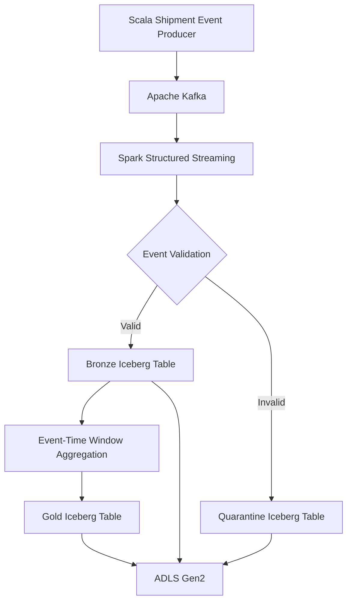
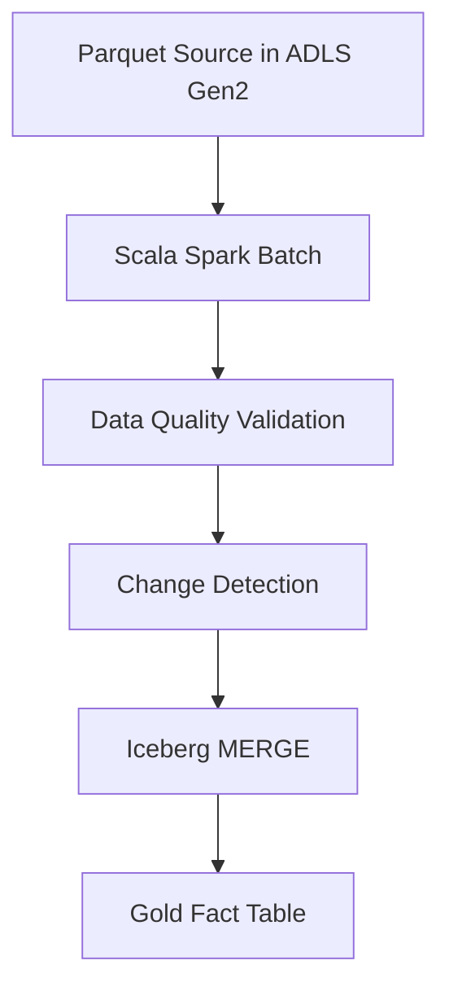

# Project Meridian – System Architecture

## 1. Overview

Project Meridian is a Scala-first logistics data engineering platform supporting batch processing and real-time shipment event processing.

The platform combines Apache Kafka, Apache Spark, Apache Iceberg, and Azure Data Lake Storage Gen2 to support reliable shipment event ingestion, processing, storage, and analytics.

## 2. Technology Components

| Component | Responsibility |
|---|---|
| Scala | Application development and event production |
| Apache Kafka | Shipment event ingestion and buffering |
| Apache Spark | Batch and Structured Streaming processing |
| Apache Iceberg | ACID table storage, snapshots, and metadata |
| Azure Data Lake Storage Gen2 | Persistent data storage |
| Docker | Containerized execution environment |

## 3. Real-Time Streaming Architecture

## 4. Batch Processing Architecture

## 5. Data Layers

### Bronze Layer

- Stores accepted shipment events.
- Preserves Kafka partition and offset metadata.
- Uses Apache Iceberg for reliable table storage.

### Quarantine Layer

- Stores invalid shipment events separately.
- Records validation status and source metadata.
- Separates malformed events from accepted records.

### Gold Layer

- Stores processed shipment event window metrics.
- Supports analytical queries on shipment activity.
- Uses Iceberg tables in ADLS Gen2.

## 6. Reliability and Fault Tolerance

- Kafka partition and offset-based idempotency.
- Iceberg MERGE operations for incremental batch processing.
- Spark Structured Streaming checkpoints.
- Event-time processing with watermarks.
- Graceful application restart recovery using existing checkpoints.
- Separate quarantine handling for invalid events.

## 7. Storage Architecture

The Apache Iceberg warehouse is stored in Azure Data Lake Storage Gen2.

**Warehouse location:**

`abfss://meridian@adls2501.dfs.core.windows.net/iceberg/warehouse`

Iceberg metadata maintains table schemas, snapshots, manifests, and data-file references.

## 8. Monitoring and Optimization

- Streaming checkpoint inspection.
- Kafka partition and offset monitoring.
- Data quality and quarantine metrics.
- Iceberg snapshot history inspection.
- File-size and record-count analysis.
- Small-file compaction using Iceberg maintenance procedures.

## 9. Design Considerations

- Scala is used for application development and Spark processing.
- Batch and streaming workloads are handled separately.
- Invalid events are isolated rather than silently discarded.
- Checkpoints support recovery after graceful application restarts.
- Iceberg snapshots provide table history and support time travel.
- Production deployments should consider Kafka replication, alerting, and scheduled file maintenance.

## 10. Project Scope

Project Meridian demonstrates:

- Kafka-based shipment event ingestion.
- Scala-based event production.
- Spark Structured Streaming.
- Batch processing with Spark and Scala.
- Apache Iceberg Bronze, Quarantine, and Gold storage.
- Incremental processing and idempotency.
- Checkpoint-based streaming recovery.
- Iceberg partition evolution and file compaction.
- ADLS Gen2 integration.
