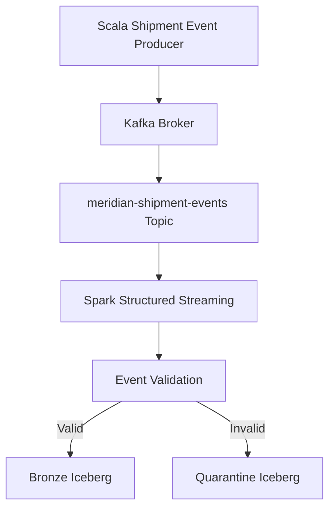

# Project Meridian - Kafka Data Ingestion

## 1. Overview

Project Meridian uses Apache Kafka as the event ingestion layer for real-time shipment tracking.

A Scala-based producer publishes shipment events to a Kafka topic. Apache Spark Structured Streaming consumes these events and processes them into Apache Iceberg tables.

## 2. Ingestion Architecture

3. Technology Used

Technology	Purpose

Scala	Shipment event producer

Apache Kafka 3.9.1	Event messaging

Kafka Producer API	Publishing shipment events

Spark Structured Streaming 4.1.3	Consuming Kafka events

Docker	Containerized execution

4. Kafka Topic Configuration

Property	Configuration

Topic name	meridian-shipment-events

Number of partitions	3

Replication factor	1

Message processing	Spark Structured Streaming

Note: Replication factor 1 is the current development configuration. Production deployments should consider multiple brokers and suitable replication.

5. Shipment Event Producer

The Scala producer publishes shipment events to Kafka.

The project includes:

- ShipmentEventProducer.scala

- IdempotencyTestProducer.scala

- KafkaConnectivityTest.scala

The dedicated idempotency test producer publishes controlled test events.

6. Event Processing

Spark Structured Streaming consumes messages from the Kafka topic.

Processing steps:

1. Read messages from Kafka.

2. Extract Kafka partition and offset metadata.

3. Parse and validate shipment event data.

4. Route valid events to the Bronze Iceberg table.

5. Route invalid events to the Quarantine Iceberg table.

6. Process valid events for Gold window analytics.

7. Offset-Based Idempotency

Kafka partition and offset values identify individual records within a topic.

Project Meridian uses the combination of:

- kafka_partition

- kafka_offset

to prevent the same Kafka record from being inserted repeatedly during replay or reprocessing.

Business-identical events published at different offsets are treated as separate Kafka records.

8. Connectivity and Deployment

Kafka and Spark execute in the Docker-based development environment.

A TCP proxy provides connectivity between the Spark container and Kafka broker.

The project includes a Kafka connectivity test to validate broker communication.

## 9. Reliability Considerations

- Kafka offsets provide source-record identification.

- Spark checkpoints preserve streaming progress.

- Invalid events are routed to quarantine.

- Kafka partitions support parallel consumption.

- Production deployments should consider replication, monitoring, and throughput.

## 10. Source Code

Main Scala producer:

src/main/scala/com/meridian/ShipmentEventProducer.scala

Additional test utilities:

- IdempotencyTestProducer.scala

- KafkaConnectivityTest.scala
