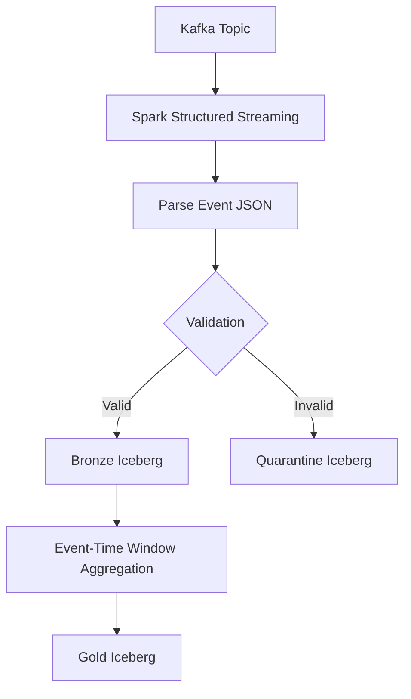

# Project Meridian - Spark Structured Streaming

## 1. Overview

Project Meridian uses Apache Spark Structured Streaming to process real-time shipment events consumed from Apache Kafka.

The streaming application is developed in Scala and writes validated shipment events into Apache Iceberg tables stored in Azure Data Lake Storage Gen2.

## 2. Streaming Architecture

## 3. Technology Stack

| Technology | Responsibility |

|---|---|

| Scala | Streaming application |

| Apache Spark 4.1.3 | Distributed stream processing |

| Spark Structured Streaming | Kafka event consumption |

| Apache Kafka 3.9.1 | Event source |

| Apache Iceberg 1.12.0 | Table storage |

| ADLS Gen2 | Persistent storage |

## 4. Processing Workflow

1. Connect to the Kafka shipment topic.

2. Read incoming Kafka records.

3. Extract message payload, partition, and offset.

4. Parse shipment event JSON.

5. Validate required shipment fields.

6. Write valid events to Bronze.

7. Write invalid events to Quarantine.

8. Perform event-time window aggregation.

9. Write aggregated metrics to Gold.

## 5. Checkpointing

Structured Streaming checkpoints maintain processing progress.

Checkpoint locations used by the project:

- `/tmp/meridian-checkpoints/shipment-events-iceberg`

- `/tmp/meridian-checkpoints/shipment-event-window-analytics`

These locations are reused during graceful application restarts to recover streaming progress.

## 6. Data Quality

The streaming pipeline separates accepted and rejected records.

Observed validation outcomes:

| Validation result | Records |

|---|---:|

| Accepted Bronze records | 17 |

| Quarantined records | 6 |

| Total accounted records | 23 |

Observed quarantine reasons:

| Reason | Records |

|---|---:|

| INVALID_JSON | 3 |

| MISSING_SHIPMENT_ID | 3 |

These figures represent the validation results observed during project testing, not a permanent production benchmark.

## 7. Event-Time Processing

The Gold processing pipeline uses event-time windows to aggregate shipment events.

Window-based processing supports analytical metrics such as event counts by event type and time interval.

Watermarks are used to manage late-arriving events.

## 8. Idempotency

The application uses Kafka partition and offset metadata to identify source records.

Duplicate source offsets are filtered to prevent repeated processing of the same Kafka record.

Different Kafka offsets containing business-identical events remain distinct records.

## 9. Recovery and Monitoring

The project was tested with graceful streaming application stop and restart using the existing checkpoint locations.

Monitoring activities included:

- Streaming process inspection.

- Checkpoint offset inspection.

- Kafka partition offset comparison.

- Error log inspection.

- Bronze, Quarantine, and Gold table validation.

## 10. Scala Implementation

Main streaming application:

`src/main/scala/com/meridian/ShipmentEventIcebergStreaming.scala`

Additional streaming implementation:

`src/main/scala/com/meridian/ShipmentEventStreaming.scala`
