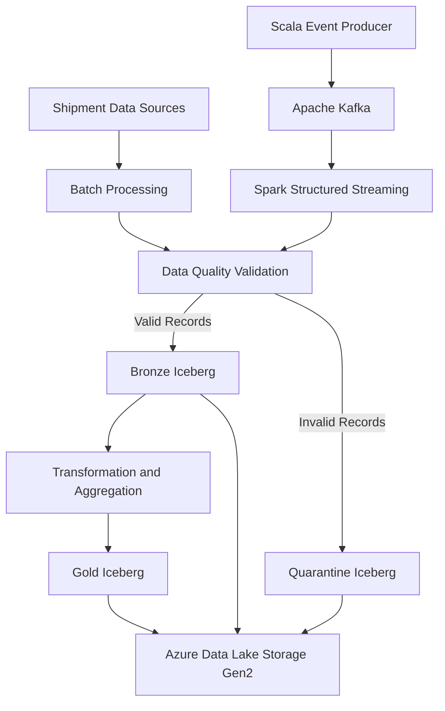
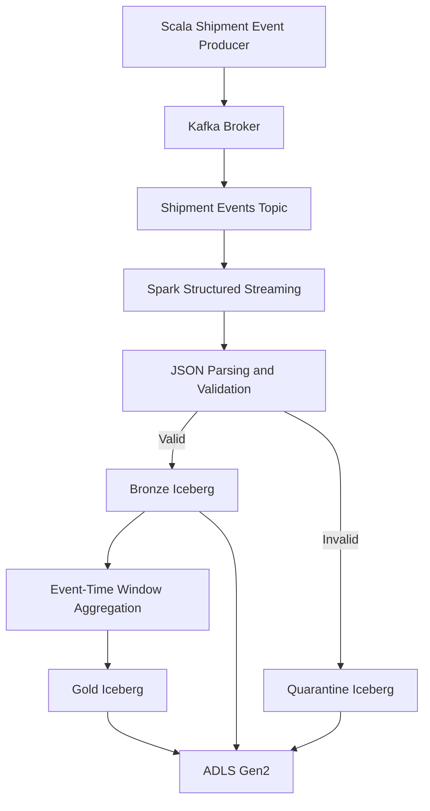
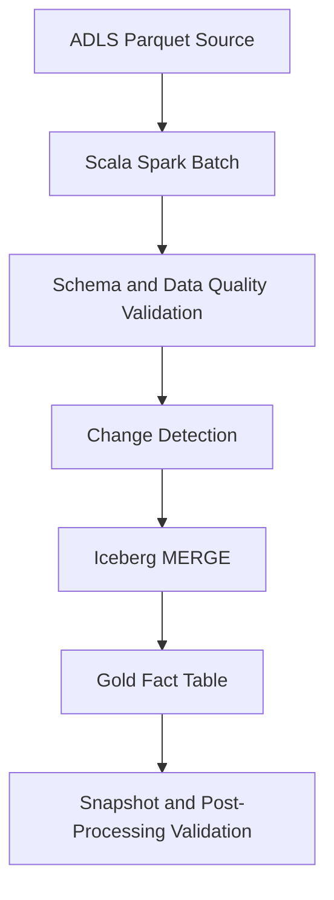

# Project Meridian - Unified Logistics Intelligence Platform

A Scala-first logistics data engineering platform combining incremental batch processing and real-time shipment event processing using Apache Kafka, Apache Spark, Apache Iceberg, and Azure Data Lake Storage Gen2.

## Overview

Project Meridian is designed to process shipment data through both batch and streaming pipelines.

The platform supports:

- Incremental shipment data ingestion and processing.
- Real-time shipment event ingestion through Apache Kafka.
- Distributed processing using Scala and Apache Spark.
- Data quality validation and quarantine handling.
- ACID table management using Apache Iceberg.
- Persistent analytical storage in Azure Data Lake Storage Gen2.
- Event-time window aggregation.
- Checkpoint-based streaming recovery.
- Kafka partition and offset-based idempotency.
- Iceberg partition evolution and file compaction.

## Architecture

### Unified Platform Architecture



### Real-Time Streaming Architecture



### Batch Processing Architecture



## Technology Stack

| Technology | Version | Responsibility |
|---|---|---|
| Scala | 2.13.17 | Application development |
| Apache Spark | 4.1.3 | Distributed processing |
| Spark Structured Streaming | 4.1.3 | Real-time event processing |
| Apache Kafka | 3.9.1 | Event ingestion |
| Apache Iceberg | 1.12.0 | ACID table storage |
| Hadoop Azure | 3.4.2 | ADLS connectivity |
| Java | 17 | Runtime |
| sbt | Project build | Scala build management |
| Docker | Containerized environment | Runtime deployment |
| Azure Data Lake Storage Gen2 | Cloud storage | Persistent data storage |

## Data Architecture

Project Meridian follows a layered data organization.

| Layer | Responsibility |
|---|---|
| Bronze | Stores accepted shipment records |
| Quarantine | Stores invalid records with validation details |
| Gold | Stores processed shipment data and analytical aggregates |

The layers separate ingestion, data quality handling, and analytical processing.

## Major Components

### 1. Kafka Event Ingestion

- Scala-based shipment event producer.
- Kafka shipment topic with three partitions.
- Kafka producer and connectivity test utilities.
- Partition and offset metadata extraction.
- TCP proxy-based connectivity from the Spark container.

### 2. Spark Structured Streaming

- Kafka event consumption.
- JSON parsing and validation.
- Valid and invalid event separation.
- Bronze and Quarantine Iceberg writes.
- Event-time window aggregation.
- Checkpoint-based recovery.

### 3. Incremental Batch Processing

- Parquet source ingestion.
- Null and duplicate shipment ID validation.
- 22-column schema validation.
- Incremental INSERT and UPDATE using Iceberg MERGE.
- Null-safe change detection.
- Idempotent batch execution.
- Snapshot reporting and post-processing validation.

### 4. Apache Iceberg Storage

- ACID table operations.
- Snapshot history inspection.
- Partition evolution.
- Metadata and data-file inspection.
- Small-file compaction.
- Snapshot expiration testing.

### 5. Azure Data Lake Storage

Iceberg warehouse location:

`abfss://meridian@adls2501.dfs.core.windows.net/iceberg/warehouse`

ADLS authentication is configured through the project launcher using a secret file or environment variable.

Credentials are not stored in the source repository.

## Scala Applications

Source directory:

`src/main/scala/com/meridian/`

| Scala File | Responsibility |
|---|---|
| ShipmentEventProducer.scala | Shipment event producer |
| ShipmentEventIcebergStreaming.scala | Streaming application with Iceberg integration |
| ShipmentEventStreaming.scala | Additional streaming implementation |
| FactShipmentIcebergBatch.scala | Incremental batch processing |
| IdempotencyTestProducer.scala | Idempotency test producer |
| KafkaConnectivityTest.scala | Kafka connectivity testing |
| CreateInsertTestSource.scala | Batch insert test data |
| CreateUpdateTestSource.scala | Batch update test data |

## Repository Structure

```text
meridian-iceberg/
|
|-- Architecture/
|   |-- system-architecture.md
|
|-- Data_Ingestion/
|   |-- kafka-ingestion.md
|
|-- Development/
|   |-- spark-streaming-processing.md
|
|-- Documentation/
|   |-- deployment-guide.md
|
|-- Logging/
|   |-- monitoring-and-observability.md
|
|-- Testing/
|   |-- validation-results.md
|
|-- Screenshots/
|   |-- Kafka/
|   |-- Spark/
|   |-- Iceberg/
|   |-- ADLS/
|
|-- src/
|   |-- main/
|       |-- scala/
|           |-- com/
|               |-- meridian/
|
|-- build.sbt
|-- start-meridian-iceberg.sh
|-- DDL_Execution.sql
|-- README.md
|-- .gitignore
```

## Development Environment

The development environment uses Docker containers.

| Container | Image |
|---|---|
| meridian-iceberg | apache/spark:4.1.3-scala2.13-java17-python3-ubuntu |
| social-media-kafka | apache/kafka:3.9.1 |

Development ports:

- Kafka: 9092
- Spark UI: 4040

The Spark environment connects to Kafka through the configured TCP proxy.

## Build

Compile the Scala project:

```bash
sbt clean compile
```

Package the application:

```bash
sbt package
```

Spark dependencies use the Provided scope because they are supplied by the Spark runtime.

Iceberg and Hadoop Azure runtime packages are supplied through the Spark launcher.

## Testing and Validation

Project Meridian has been tested across the following areas:

| Test Area | Validation |
|---|---|
| Kafka connectivity | Spark-to-Kafka connectivity |
| Event ingestion | Kafka event consumption |
| Data quality | Bronze and Quarantine routing |
| Idempotency | Kafka partition and offset-based handling |
| Recovery | Graceful restart using existing checkpoints |
| End-to-end processing | Bronze, Quarantine, and Gold validation |
| Partition evolution | Monthly-to-daily partition evolution |
| Query optimization | Filter pushdown and column pruning inspection |
| File compaction | Six files rewritten into one on a dedicated test table |

### Observed Streaming Data Quality Results

| Metric | Records |
|---|---:|
| Accepted Bronze records | 17 |
| Quarantined records | 6 |
| Total accounted records | 23 |

Quarantine breakdown:

| Validation Reason | Records |
|---|---:|
| INVALID_JSON | 3 |
| MISSING_SHIPMENT_ID | 3 |

These values represent development testing observations, not production benchmarks.

### Batch Processing Validation

Batch tests were executed against the dedicated table:

`meridian_adls.gold.fact_shipment_batch_test`

| Metric | Result |
|---|---:|
| Initial target rows | 116 |
| Final target rows | 117 |
| Distinct shipment IDs | 117 |
| Null shipment IDs | 0 |
| Update test | Passed |
| Insert test | Passed |
| Idempotency test | Passed |

The production table was not modified by these batch tests.

For detailed test evidence, see [Testing and Validation Results](Testing/validation-results.md).

## Documentation

| Document | Description |
|---|---|
| [System Architecture](Architecture/system-architecture.md) | Platform architecture and design |
| [Kafka Ingestion](Data_Ingestion/kafka-ingestion.md) | Kafka ingestion architecture |
| [Spark Streaming Processing](Development/spark-streaming-processing.md) | Structured Streaming workflow |
| [Deployment Guide](Documentation/deployment-guide.md) | Development setup and configuration |
| [Monitoring and Observability](Logging/monitoring-and-observability.md) | Logs, checkpoints, offsets, and Iceberg metadata |
| [Testing and Validation](Testing/validation-results.md) | Testing evidence and results |

## Security

- Never commit Azure SAS tokens or credentials.
- Keep `.secrets/` outside source control.
- Use secure secret injection for ADLS authentication.
- Exclude generated JAR files and runtime warehouse data.
- Avoid exposing sensitive configuration in logs or screenshots.

## Current Limitations

- Kafka development configuration uses replication factor 1.
- Low-volume streaming writes can generate small files.
- Business-level deduplication requires a stable event identifier.
- Automated alerting and centralized monitoring are not yet implemented.
- Hard-crash recovery and sustained-load performance benchmarking remain future validation areas.

## Future Enhancements

- Business-level event deduplication using stable event identifiers.
- Automated streaming health and data quality alerts.
- Kafka multi-broker deployment.
- GitHub Actions CI/CD integration.
- Production-grade Spark resource management.
- Automated Iceberg maintenance and compaction.
- Centralized observability dashboards.
- Kubernetes-based deployment.

## Project Objective

Project Meridian demonstrates the design and implementation of a unified logistics data engineering platform using Scala, Apache Kafka, Apache Spark, Apache Iceberg, and Azure Data Lake Storage Gen2.

The project brings together incremental batch processing, real-time event processing, data quality management, reliable storage, and analytical data preparation in one platform.
